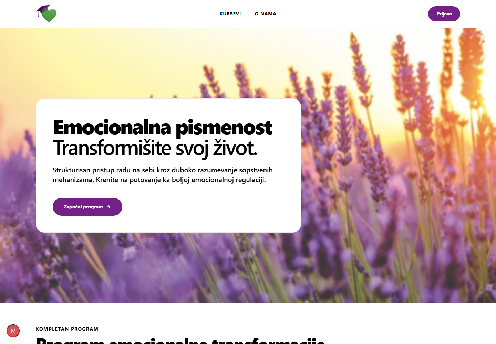

# Emocionalna pismenost

### An e-learning platform for emotional literacy and assertive communication

A full-stack web application that brings structured courses, video lessons, interactive exercises, and learning progress into one experience. The interface and learning content are in Serbian.

**Next.js 16 · React 19 · JavaScript · Tailwind CSS · Supabase · PostgreSQL**

[Features](#features) · [Code highlights](#code-highlights) · [Run locally](#run-locally) · [Project status](#project-status)

## Preview



*Homepage captured from the locally running application.*

## Features

- **Structured learning:** courses are organized into modules and lessons, with previous/next navigation and a lesson sidebar.
- **Video lessons:** support for local MP4 playback with volume controls and embedded YouTube videos.
- **Six interactive assertiveness exercises:** a self-assessment questionnaire, communication styles, assertive rights, personal rights, compliments, and a rating matrix.
- **Learning progress:** signed-in users can mark lessons complete and see their progress through a module.
- **Accounts and profiles:** email/password authentication, Google sign-in integration, password recovery, profile name editing, and a personal course library.
- **Course access flow:** free lesson previews and enrollment-based access, with a simulated checkout for courses or individual modules.
- **Responsive interface:** layouts for desktop and mobile, with a shared navigation, reusable exercise components, and a consistent visual theme.

## Code highlights

| Area | Implementation | Explore |
| --- | --- | --- |
| Server and client rendering | App Router pages load course data; client components handle playback, forms, and exercises. | [Course routes](src/app/%28course%29/course) |
| Authentication | Supabase SSR clients integrate sessions with cookies; Server Actions implement account flows. | [Auth actions](src/actions/auth.js) · [Supabase clients](src/lib/supabase) |
| Persistent progress | A Server Action writes lesson completion to Supabase and revalidates the current page. | [Progress action](src/actions/progress.js) |
| Interactive learning | Six dedicated exercise components share UI primitives and a versioned result format. | [Assertiveness exercises](src/components/lessons/asertivnost) |
| Access and enrollment | Lesson pages read enrollment and module access records; a mock API route demonstrates the purchase flow. | [Lesson page](src/app/%28course%29/course/%5BcourseSlug%5D/module/%5BmoduleSlug%5D/lesson/%5BlessonSlug%5D/page.js) · [Mock checkout](src/app/api/webhooks/mock-payment/route.js) |

## Technology

| Layer | Tools |
| --- | --- |
| Application | Next.js 16 App Router, React 19, JavaScript |
| Styling | Tailwind CSS 3, CSS custom properties, React Icons |
| Backend and data | Supabase Auth, PostgreSQL, Supabase Storage |
| Server logic | Next.js Server Actions and Route Handlers |

Originally developed as `MERN-v2`, the project now lives in `Full-Stack-LMS` and uses Next.js and Supabase.

## Run locally

**Requirements:** Node.js 20.9+ and npm, plus a configured Supabase project.

```bash
git clone https://github.com/ejkej47/Full-Stack-LMS.git
cd Full-Stack-LMS
npm ci
```

Create `.env.local` in the project root:

```dotenv
NEXT_PUBLIC_SUPABASE_URL=https://your-project.supabase.co
NEXT_PUBLIC_SUPABASE_ANON_KEY=your-supabase-anon-key
SUPABASE_SERVICE_ROLE_KEY=your-server-only-service-role-key
NEXT_PUBLIC_SITE_URL=http://localhost:3000
```

The service role key is used by the mock checkout endpoint and must remain server-only. Do not commit `.env.local`.

The application expects an existing database and course content. **Database migrations and seed data are not included**, so environment variables alone do not reproduce a fully populated installation. The code references `courses`, `modules`, `lessons`, `profiles`, `enrollments`, `user_module_access`, `user_lesson_progress`, `transactions`, and the legacy `user_quiz_results` table.

For a separate Supabase project, configure its schema, relationships, and access policies; upload course images to the public `Course-assets` bucket; and update the allowed image hostname in `next.config.js`. Email and Google sign-in also require the corresponding Supabase Auth provider and redirect settings.

```bash
npm run dev
```

Open [localhost:3000](http://localhost:3000). The development script uses webpack. To build and serve a production bundle:

```bash
npm run build
npm start
```

## Project structure

```text
src/
  app/
    (auth)/                 Login, registration, password recovery
    (course)/               Course, module, and lesson pages
    (dashboard)/            Profile and personal course library
    api/webhooks/           Mock payment endpoint
  actions/                  Authentication, profile, progress, quiz actions
  components/
    course/                 Video player and mock checkout
    lessons/asertivnost/    Six exercises and shared exercise UI
    quiz/                   Generic quiz blocks
    layout/                 Navigation and footer
  lib/supabase/             Browser, server, and admin clients
public/                     Images, icons, and prototype lesson video
docs/                       Exercise result documentation and screenshots
```

## Project status

This is an actively developed prototype. The course experience, authentication flows, progress tracking, and interactive exercises are implemented; some integrations remain unfinished:

- **Payments are simulated.** The mock endpoint writes transaction and access records without charging a payment method. A verified payment provider integration and server-side authorization are needed before production use.
- **Exercise results are temporary.** The six assertiveness exercises calculate results in page state; they do not yet persist answers or provide result history. The older quiz action still contains placeholder scores. See [exercise result notes](docs/asertivnost-results.md).
- **Some navigation and content are placeholders.** The catalog route is `/courses`, while some links still point to `/kursevi`; informational pages and some promotional content remain unfinished.
- **Reproducible setup and automated checks remain to be added.** The repository currently has no database migration/seed workflow or test/lint scripts.
